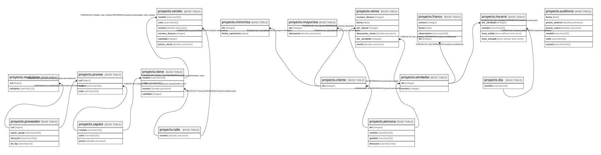

# facu

## Tables

| Name | Columns | Comment | Type |
| ---- | ------- | ------- | ---- |
| [proyecto.zapato](proyecto.zapato.md) | 3 |  | BASE TABLE |
| [proyecto.talle](proyecto.talle.md) | 1 |  | BASE TABLE |
| [proyecto.proveedor](proyecto.proveedor.md) | 4 |  | BASE TABLE |
| [proyecto.mcelulares](proyecto.mcelulares.md) | 2 |  | BASE TABLE |
| [proyecto.persona](proyecto.persona.md) | 4 |  | BASE TABLE |
| [proyecto.vendedor](proyecto.vendedor.md) | 2 |  | BASE TABLE |
| [proyecto.cliente](proyecto.cliente.md) | 1 |  | BASE TABLE |
| [proyecto.minorista](proyecto.minorista.md) | 2 |  | BASE TABLE |
| [proyecto.mayorista](proyecto.mayorista.md) | 2 |  | BASE TABLE |
| [proyecto.venta](proyecto.venta.md) | 6 |  | BASE TABLE |
| [proyecto.franco](proyecto.franco.md) | 4 |  | BASE TABLE |
| [proyecto.dia](proyecto.dia.md) | 1 |  | BASE TABLE |
| [proyecto.provee](proyecto.provee.md) | 3 |  | BASE TABLE |
| [proyecto.tiene](proyecto.tiene.md) | 4 |  | BASE TABLE |
| [proyecto.horario](proyecto.horario.md) | 4 |  | BASE TABLE |
| [proyecto.vendio](proyecto.vendio.md) | 6 |  | BASE TABLE |
| [proyecto.auditoria](proyecto.auditoria.md) | 6 |  | BASE TABLE |

## Stored procedures and functions

| Name | ReturnType | Arguments | Type |
| ---- | ------- | ------- | ---- |
| proyecto.auditar_actualizacion_precio | trigger |  | FUNCTION |

## Relations

---

> Generated by [tbls](https://github.com/k1LoW/tbls)
