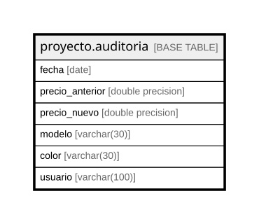

# proyecto.auditoria

## Description

## Columns

| Name | Type | Default | Nullable | Children | Parents | Comment |
| ---- | ---- | ------- | -------- | -------- | ------- | ------- |
| fecha | date |  | false |  |  |  |
| precio_anterior | double precision |  | false |  |  |  |
| precio_nuevo | double precision |  | false |  |  |  |
| modelo | varchar(30) |  | true |  |  |  |
| color | varchar(30) |  | true |  |  |  |
| usuario | varchar(100) |  | true |  |  |  |

## Constraints

| Name | Type | Definition |
| ---- | ---- | ---------- |
| auditoria_fecha_not_null | n | NOT NULL fecha |
| auditoria_precio_anterior_not_null | n | NOT NULL precio_anterior |
| auditoria_precio_nuevo_not_null | n | NOT NULL precio_nuevo |

## Relations

---

> Generated by [tbls](https://github.com/k1LoW/tbls)
