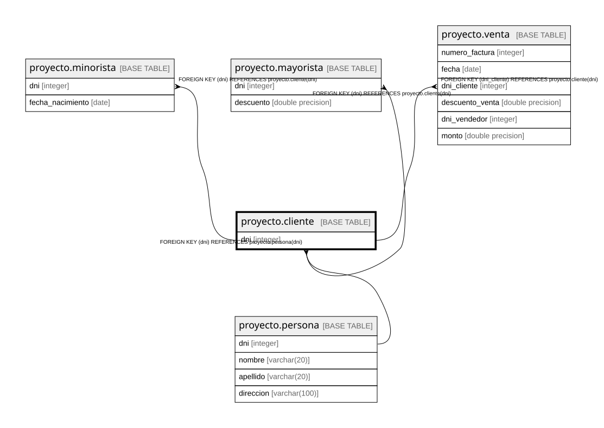

# proyecto.cliente

## Description

## Columns

| Name | Type | Default | Nullable | Children | Parents | Comment |
| ---- | ---- | ------- | -------- | -------- | ------- | ------- |
| dni | integer |  | false | [proyecto.minorista](proyecto.minorista.md) [proyecto.mayorista](proyecto.mayorista.md) [proyecto.venta](proyecto.venta.md) | [proyecto.persona](proyecto.persona.md) |  |

## Constraints

| Name | Type | Definition |
| ---- | ---- | ---------- |
| cliente_dni_not_null | n | NOT NULL dni |
| cliente_dni_fkey | FOREIGN KEY | FOREIGN KEY (dni) REFERENCES proyecto.persona(dni) |
| cliente_pkey | PRIMARY KEY | PRIMARY KEY (dni) |

## Indexes

| Name | Definition |
| ---- | ---------- |
| cliente_pkey | CREATE UNIQUE INDEX cliente_pkey ON proyecto.cliente USING btree (dni) |

## Relations

---

> Generated by [tbls](https://github.com/k1LoW/tbls)
