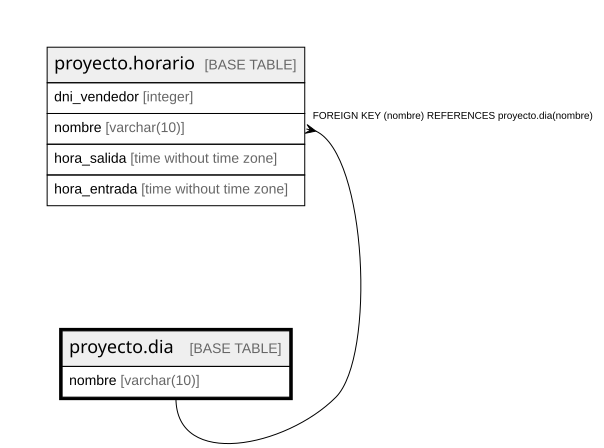

# proyecto.dia

## Description

## Columns

| Name | Type | Default | Nullable | Children | Parents | Comment |
| ---- | ---- | ------- | -------- | -------- | ------- | ------- |
| nombre | varchar(10) |  | false | [proyecto.horario](proyecto.horario.md) |  |  |

## Constraints

| Name | Type | Definition |
| ---- | ---- | ---------- |
| dia_nombre_not_null | n | NOT NULL nombre |
| dia_pkey | PRIMARY KEY | PRIMARY KEY (nombre) |

## Indexes

| Name | Definition |
| ---- | ---------- |
| dia_pkey | CREATE UNIQUE INDEX dia_pkey ON proyecto.dia USING btree (nombre) |

## Relations

---

> Generated by [tbls](https://github.com/k1LoW/tbls)
