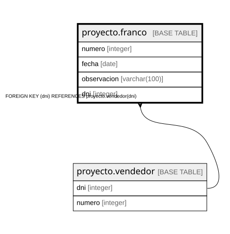

# proyecto.franco

## Description

## Columns

| Name | Type | Default | Nullable | Children | Parents | Comment |
| ---- | ---- | ------- | -------- | -------- | ------- | ------- |
| numero | integer |  | false |  |  |  |
| fecha | date |  | false |  |  |  |
| observacion | varchar(100) |  | true |  |  |  |
| dni | integer |  | false |  | [proyecto.vendedor](proyecto.vendedor.md) |  |

## Constraints

| Name | Type | Definition |
| ---- | ---- | ---------- |
| franco_dni_not_null | n | NOT NULL dni |
| franco_fecha_not_null | n | NOT NULL fecha |
| franco_numero_not_null | n | NOT NULL numero |
| franco_dni_fkey | FOREIGN KEY | FOREIGN KEY (dni) REFERENCES proyecto.vendedor(dni) |
| franco_pkey | PRIMARY KEY | PRIMARY KEY (numero) |

## Indexes

| Name | Definition |
| ---- | ---------- |
| franco_pkey | CREATE UNIQUE INDEX franco_pkey ON proyecto.franco USING btree (numero) |

## Relations

---

> Generated by [tbls](https://github.com/k1LoW/tbls)
