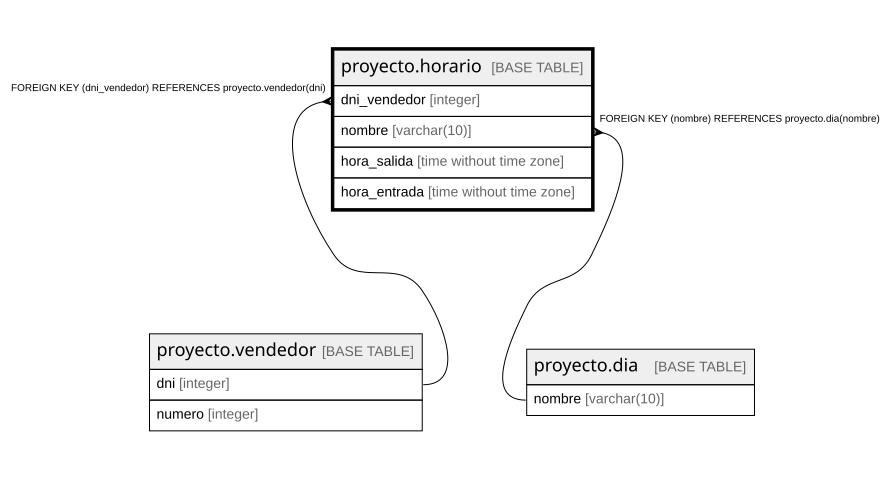

# proyecto.horario

## Description

## Columns

| Name | Type | Default | Nullable | Children | Parents | Comment |
| ---- | ---- | ------- | -------- | -------- | ------- | ------- |
| dni_vendedor | integer |  | false |  | [proyecto.vendedor](proyecto.vendedor.md) |  |
| nombre | varchar(10) |  | false |  | [proyecto.dia](proyecto.dia.md) |  |
| hora_salida | time without time zone |  | false |  |  |  |
| hora_entrada | time without time zone |  | false |  |  |  |

## Constraints

| Name | Type | Definition |
| ---- | ---- | ---------- |
| horario_dni_vendedor_not_null | n | NOT NULL dni_vendedor |
| horario_hora_entrada_not_null | n | NOT NULL hora_entrada |
| horario_hora_salida_not_null | n | NOT NULL hora_salida |
| horario_nombre_not_null | n | NOT NULL nombre |
| horario_dni_vendedor_fkey | FOREIGN KEY | FOREIGN KEY (dni_vendedor) REFERENCES proyecto.vendedor(dni) |
| horario_nombre_fkey | FOREIGN KEY | FOREIGN KEY (nombre) REFERENCES proyecto.dia(nombre) |
| pkhorario | PRIMARY KEY | PRIMARY KEY (dni_vendedor, nombre) |

## Indexes

| Name | Definition |
| ---- | ---------- |
| pkhorario | CREATE UNIQUE INDEX pkhorario ON proyecto.horario USING btree (dni_vendedor, nombre) |

## Relations

---

> Generated by [tbls](https://github.com/k1LoW/tbls)
