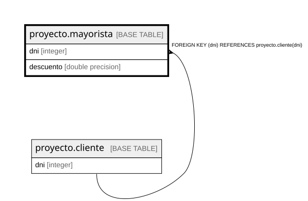

# proyecto.mayorista

## Description

## Columns

| Name | Type | Default | Nullable | Children | Parents | Comment |
| ---- | ---- | ------- | -------- | -------- | ------- | ------- |
| dni | integer |  | false |  | [proyecto.cliente](proyecto.cliente.md) |  |
| descuento | double precision |  | false |  |  |  |

## Constraints

| Name | Type | Definition |
| ---- | ---- | ---------- |
| mayorista_descuento_not_null | n | NOT NULL descuento |
| mayorista_dni_not_null | n | NOT NULL dni |
| mayorista_dni_fkey | FOREIGN KEY | FOREIGN KEY (dni) REFERENCES proyecto.cliente(dni) |
| mayorista_pkey | PRIMARY KEY | PRIMARY KEY (dni) |

## Indexes

| Name | Definition |
| ---- | ---------- |
| mayorista_pkey | CREATE UNIQUE INDEX mayorista_pkey ON proyecto.mayorista USING btree (dni) |

## Relations

---

> Generated by [tbls](https://github.com/k1LoW/tbls)
