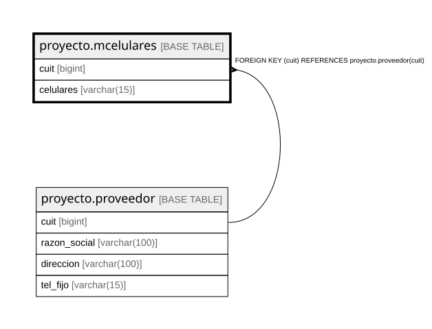

# proyecto.mcelulares

## Description

## Columns

| Name | Type | Default | Nullable | Children | Parents | Comment |
| ---- | ---- | ------- | -------- | -------- | ------- | ------- |
| cuit | bigint |  | false |  | [proyecto.proveedor](proyecto.proveedor.md) |  |
| celulares | varchar(15) |  | false |  |  |  |

## Constraints

| Name | Type | Definition |
| ---- | ---- | ---------- |
| mcelulares_celulares_not_null | n | NOT NULL celulares |
| mcelulares_cuit_not_null | n | NOT NULL cuit |
| fkproveedor | FOREIGN KEY | FOREIGN KEY (cuit) REFERENCES proyecto.proveedor(cuit) |
| pkcelulares | PRIMARY KEY | PRIMARY KEY (cuit, celulares) |

## Indexes

| Name | Definition |
| ---- | ---------- |
| pkcelulares | CREATE UNIQUE INDEX pkcelulares ON proyecto.mcelulares USING btree (cuit, celulares) |

## Relations

---

> Generated by [tbls](https://github.com/k1LoW/tbls)
