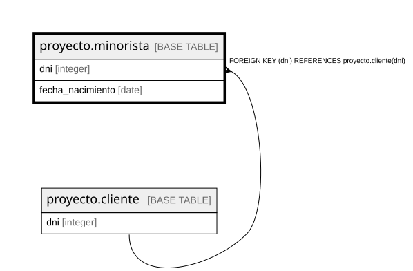

# proyecto.minorista

## Description

## Columns

| Name | Type | Default | Nullable | Children | Parents | Comment |
| ---- | ---- | ------- | -------- | -------- | ------- | ------- |
| dni | integer |  | false |  | [proyecto.cliente](proyecto.cliente.md) |  |
| fecha_nacimiento | date |  | false |  |  |  |

## Constraints

| Name | Type | Definition |
| ---- | ---- | ---------- |
| minorista_dni_not_null | n | NOT NULL dni |
| minorista_fecha_nacimiento_not_null | n | NOT NULL fecha_nacimiento |
| minorista_dni_fkey | FOREIGN KEY | FOREIGN KEY (dni) REFERENCES proyecto.cliente(dni) |
| minorista_pkey | PRIMARY KEY | PRIMARY KEY (dni) |

## Indexes

| Name | Definition |
| ---- | ---------- |
| minorista_pkey | CREATE UNIQUE INDEX minorista_pkey ON proyecto.minorista USING btree (dni) |

## Relations

---

> Generated by [tbls](https://github.com/k1LoW/tbls)
