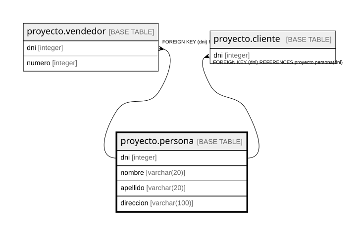

# proyecto.persona

## Description

## Columns

| Name | Type | Default | Nullable | Children | Parents | Comment |
| ---- | ---- | ------- | -------- | -------- | ------- | ------- |
| dni | integer |  | false | [proyecto.vendedor](proyecto.vendedor.md) [proyecto.cliente](proyecto.cliente.md) |  |  |
| nombre | varchar(20) |  | false |  |  |  |
| apellido | varchar(20) |  | false |  |  |  |
| direccion | varchar(100) |  | true |  |  |  |

## Constraints

| Name | Type | Definition |
| ---- | ---- | ---------- |
| persona_apellido_not_null | n | NOT NULL apellido |
| persona_dni_not_null | n | NOT NULL dni |
| persona_nombre_not_null | n | NOT NULL nombre |
| persona_pkey | PRIMARY KEY | PRIMARY KEY (dni) |

## Indexes

| Name | Definition |
| ---- | ---------- |
| persona_pkey | CREATE UNIQUE INDEX persona_pkey ON proyecto.persona USING btree (dni) |

## Relations

---

> Generated by [tbls](https://github.com/k1LoW/tbls)
