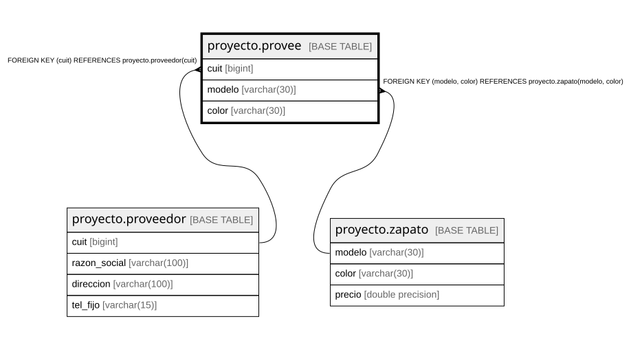

# proyecto.provee

## Description

## Columns

| Name | Type | Default | Nullable | Children | Parents | Comment |
| ---- | ---- | ------- | -------- | -------- | ------- | ------- |
| cuit | bigint |  | false |  | [proyecto.proveedor](proyecto.proveedor.md) |  |
| modelo | varchar(30) |  | false |  | [proyecto.zapato](proyecto.zapato.md) |  |
| color | varchar(30) |  | false |  | [proyecto.zapato](proyecto.zapato.md) |  |

## Constraints

| Name | Type | Definition |
| ---- | ---- | ---------- |
| provee_color_not_null | n | NOT NULL color |
| provee_cuit_not_null | n | NOT NULL cuit |
| provee_modelo_not_null | n | NOT NULL modelo |
| fkprovee | FOREIGN KEY | FOREIGN KEY (modelo, color) REFERENCES proyecto.zapato(modelo, color) |
| provee_cuit_fkey | FOREIGN KEY | FOREIGN KEY (cuit) REFERENCES proyecto.proveedor(cuit) |

## Relations

---

> Generated by [tbls](https://github.com/k1LoW/tbls)
