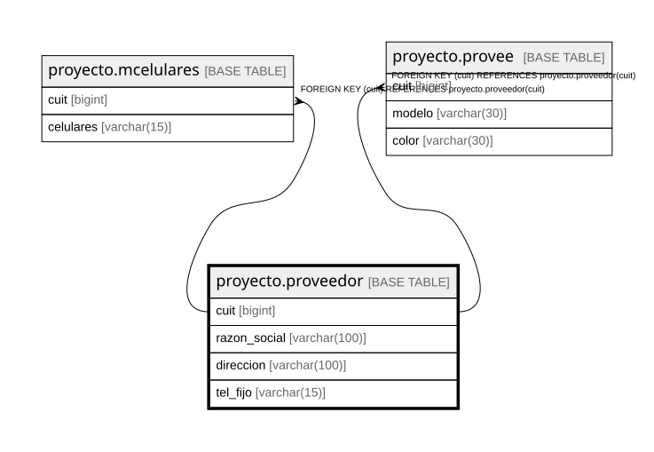

# proyecto.proveedor

## Description

## Columns

| Name | Type | Default | Nullable | Children | Parents | Comment |
| ---- | ---- | ------- | -------- | -------- | ------- | ------- |
| cuit | bigint |  | false | [proyecto.mcelulares](proyecto.mcelulares.md) [proyecto.provee](proyecto.provee.md) |  |  |
| razon_social | varchar(100) |  | false |  |  |  |
| direccion | varchar(100) |  | false |  |  |  |
| tel_fijo | varchar(15) |  | true |  |  |  |

## Constraints

| Name | Type | Definition |
| ---- | ---- | ---------- |
| proveedor_cuit_not_null | n | NOT NULL cuit |
| proveedor_direccion_not_null | n | NOT NULL direccion |
| proveedor_razon_social_not_null | n | NOT NULL razon_social |
| proveedor_pkey | PRIMARY KEY | PRIMARY KEY (cuit) |
| ccrazon_social | UNIQUE | UNIQUE (razon_social) |

## Indexes

| Name | Definition |
| ---- | ---------- |
| proveedor_pkey | CREATE UNIQUE INDEX proveedor_pkey ON proyecto.proveedor USING btree (cuit) |
| ccrazon_social | CREATE UNIQUE INDEX ccrazon_social ON proyecto.proveedor USING btree (razon_social) |

## Relations

---

> Generated by [tbls](https://github.com/k1LoW/tbls)
