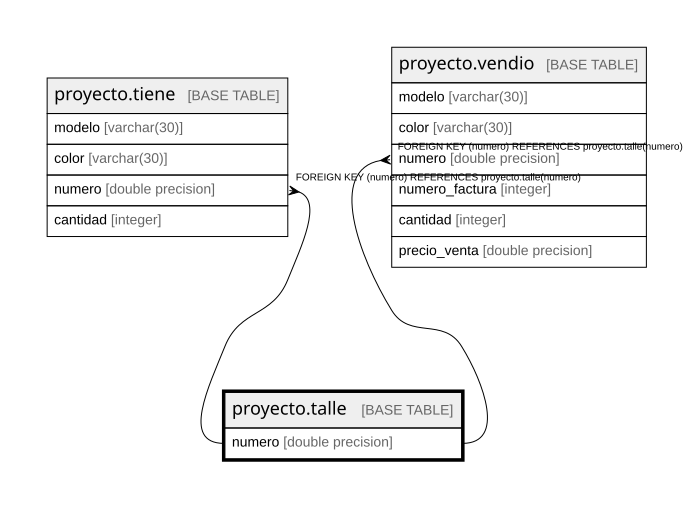

# proyecto.talle

## Description

## Columns

| Name | Type | Default | Nullable | Children | Parents | Comment |
| ---- | ---- | ------- | -------- | -------- | ------- | ------- |
| numero | double precision |  | false | [proyecto.tiene](proyecto.tiene.md) [proyecto.vendio](proyecto.vendio.md) |  |  |

## Constraints

| Name | Type | Definition |
| ---- | ---- | ---------- |
| talle_numero_not_null | n | NOT NULL numero |
| talle_pkey | PRIMARY KEY | PRIMARY KEY (numero) |

## Indexes

| Name | Definition |
| ---- | ---------- |
| talle_pkey | CREATE UNIQUE INDEX talle_pkey ON proyecto.talle USING btree (numero) |

## Relations

---

> Generated by [tbls](https://github.com/k1LoW/tbls)
