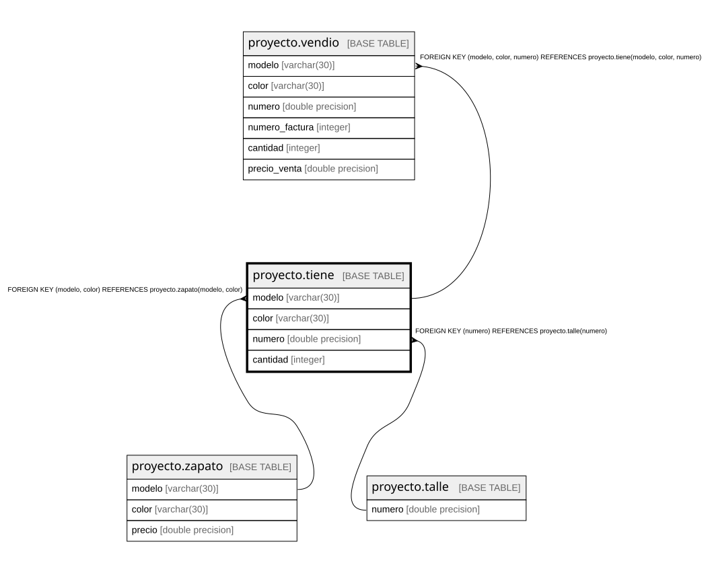

# proyecto.tiene

## Description

## Columns

| Name | Type | Default | Nullable | Children | Parents | Comment |
| ---- | ---- | ------- | -------- | -------- | ------- | ------- |
| modelo | varchar(30) |  | false | [proyecto.vendio](proyecto.vendio.md) | [proyecto.zapato](proyecto.zapato.md) |  |
| color | varchar(30) |  | false | [proyecto.vendio](proyecto.vendio.md) | [proyecto.zapato](proyecto.zapato.md) |  |
| numero | double precision |  | false | [proyecto.vendio](proyecto.vendio.md) | [proyecto.talle](proyecto.talle.md) |  |
| cantidad | integer |  | false |  |  |  |

## Constraints

| Name | Type | Definition |
| ---- | ---- | ---------- |
| tiene_cantidad_not_null | n | NOT NULL cantidad |
| tiene_color_not_null | n | NOT NULL color |
| tiene_modelo_not_null | n | NOT NULL modelo |
| tiene_numero_not_null | n | NOT NULL numero |
| fkprovee | FOREIGN KEY | FOREIGN KEY (modelo, color) REFERENCES proyecto.zapato(modelo, color) |
| tiene_numero_fkey | FOREIGN KEY | FOREIGN KEY (numero) REFERENCES proyecto.talle(numero) |
| pktiene | PRIMARY KEY | PRIMARY KEY (modelo, color, numero) |

## Indexes

| Name | Definition |
| ---- | ---------- |
| pktiene | CREATE UNIQUE INDEX pktiene ON proyecto.tiene USING btree (modelo, color, numero) |

## Relations

---

> Generated by [tbls](https://github.com/k1LoW/tbls)
