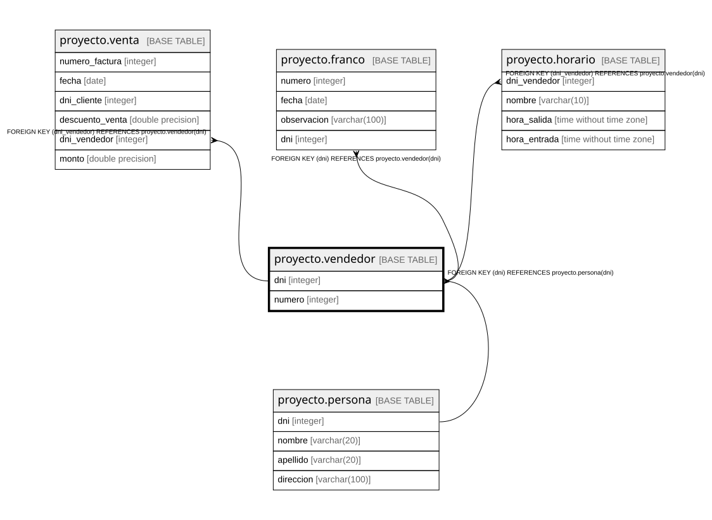

# proyecto.vendedor

## Description

## Columns

| Name | Type | Default | Nullable | Children | Parents | Comment |
| ---- | ---- | ------- | -------- | -------- | ------- | ------- |
| dni | integer |  | false | [proyecto.venta](proyecto.venta.md) [proyecto.franco](proyecto.franco.md) [proyecto.horario](proyecto.horario.md) | [proyecto.persona](proyecto.persona.md) |  |
| numero | integer |  | false |  |  |  |

## Constraints

| Name | Type | Definition |
| ---- | ---- | ---------- |
| vendedor_dni_not_null | n | NOT NULL dni |
| vendedor_numero_not_null | n | NOT NULL numero |
| vendedor_dni_fkey | FOREIGN KEY | FOREIGN KEY (dni) REFERENCES proyecto.persona(dni) |
| vendedor_pkey | PRIMARY KEY | PRIMARY KEY (dni) |
| ccnumero_vendedor | UNIQUE | UNIQUE (numero) |

## Indexes

| Name | Definition |
| ---- | ---------- |
| vendedor_pkey | CREATE UNIQUE INDEX vendedor_pkey ON proyecto.vendedor USING btree (dni) |
| ccnumero_vendedor | CREATE UNIQUE INDEX ccnumero_vendedor ON proyecto.vendedor USING btree (numero) |

## Relations

---

> Generated by [tbls](https://github.com/k1LoW/tbls)
