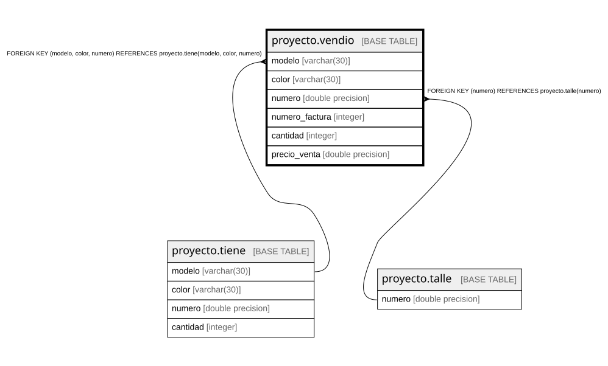

# proyecto.vendio

## Description

## Columns

| Name | Type | Default | Nullable | Children | Parents | Comment |
| ---- | ---- | ------- | -------- | -------- | ------- | ------- |
| modelo | varchar(30) |  | false |  | [proyecto.tiene](proyecto.tiene.md) |  |
| color | varchar(30) |  | false |  | [proyecto.tiene](proyecto.tiene.md) |  |
| numero | double precision |  | false |  | [proyecto.talle](proyecto.talle.md) [proyecto.tiene](proyecto.tiene.md) |  |
| numero_factura | integer |  | false |  |  |  |
| cantidad | integer |  | false |  |  |  |
| precio_venta | double precision |  | false |  |  |  |

## Constraints

| Name | Type | Definition |
| ---- | ---- | ---------- |
| vendio_cantidad_not_null | n | NOT NULL cantidad |
| vendio_color_not_null | n | NOT NULL color |
| vendio_modelo_not_null | n | NOT NULL modelo |
| vendio_numero_factura_not_null | n | NOT NULL numero_factura |
| vendio_numero_not_null | n | NOT NULL numero |
| vendio_precio_venta_not_null | n | NOT NULL precio_venta |
| vendio_numero_fkey | FOREIGN KEY | FOREIGN KEY (numero) REFERENCES proyecto.talle(numero) |
| fkvendio | FOREIGN KEY | FOREIGN KEY (modelo, color, numero) REFERENCES proyecto.tiene(modelo, color, numero) |
| pkvendio | PRIMARY KEY | PRIMARY KEY (modelo, color, numero, numero_factura) |

## Indexes

| Name | Definition |
| ---- | ---------- |
| pkvendio | CREATE UNIQUE INDEX pkvendio ON proyecto.vendio USING btree (modelo, color, numero, numero_factura) |

## Relations

---

> Generated by [tbls](https://github.com/k1LoW/tbls)
