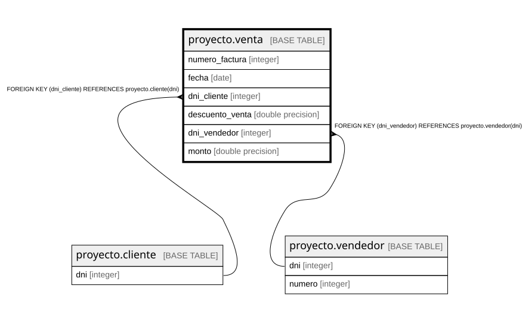

# proyecto.venta

## Description

## Columns

| Name | Type | Default | Nullable | Children | Parents | Comment |
| ---- | ---- | ------- | -------- | -------- | ------- | ------- |
| numero_factura | integer |  | false |  |  |  |
| fecha | date |  | false |  |  |  |
| dni_cliente | integer |  | false |  | [proyecto.cliente](proyecto.cliente.md) |  |
| descuento_venta | double precision |  | true |  |  |  |
| dni_vendedor | integer |  | false |  | [proyecto.vendedor](proyecto.vendedor.md) |  |
| monto | double precision |  | false |  |  |  |

## Constraints

| Name | Type | Definition |
| ---- | ---- | ---------- |
| checkdescuento | CHECK | CHECK (((descuento_venta >= (0)::double precision) AND (descuento_venta <= (100)::double precision))) |
| venta_dni_cliente_not_null | n | NOT NULL dni_cliente |
| venta_dni_vendedor_not_null | n | NOT NULL dni_vendedor |
| venta_fecha_not_null | n | NOT NULL fecha |
| venta_monto_not_null | n | NOT NULL monto |
| venta_numero_factura_not_null | n | NOT NULL numero_factura |
| venta_dni_vendedor_fkey | FOREIGN KEY | FOREIGN KEY (dni_vendedor) REFERENCES proyecto.vendedor(dni) |
| venta_dni_cliente_fkey | FOREIGN KEY | FOREIGN KEY (dni_cliente) REFERENCES proyecto.cliente(dni) |
| venta_pkey | PRIMARY KEY | PRIMARY KEY (numero_factura) |

## Indexes

| Name | Definition |
| ---- | ---------- |
| venta_pkey | CREATE UNIQUE INDEX venta_pkey ON proyecto.venta USING btree (numero_factura) |

## Relations

---

> Generated by [tbls](https://github.com/k1LoW/tbls)
