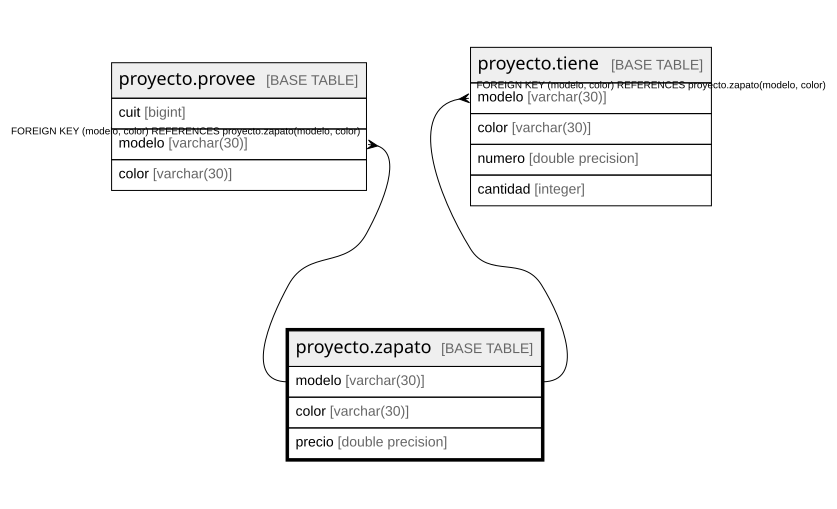

# proyecto.zapato

## Description

## Columns

| Name | Type | Default | Nullable | Children | Parents | Comment |
| ---- | ---- | ------- | -------- | -------- | ------- | ------- |
| modelo | varchar(30) |  | false | [proyecto.provee](proyecto.provee.md) [proyecto.tiene](proyecto.tiene.md) |  |  |
| color | varchar(30) |  | false | [proyecto.provee](proyecto.provee.md) [proyecto.tiene](proyecto.tiene.md) |  |  |
| precio | double precision |  | false |  |  |  |

## Constraints

| Name | Type | Definition |
| ---- | ---- | ---------- |
| checkprecio | CHECK | CHECK (((precio > (0)::double precision) AND (precio < (200000)::double precision))) |
| zapato_color_not_null | n | NOT NULL color |
| zapato_modelo_not_null | n | NOT NULL modelo |
| zapato_precio_not_null | n | NOT NULL precio |
| pkzapato | PRIMARY KEY | PRIMARY KEY (modelo, color) |

## Indexes

| Name | Definition |
| ---- | ---------- |
| pkzapato | CREATE UNIQUE INDEX pkzapato ON proyecto.zapato USING btree (modelo, color) |

## Triggers

| Name | Definition |
| ---- | ---------- |
| auditoria_precio_zapato | CREATE TRIGGER auditoria_precio_zapato AFTER UPDATE OF precio ON proyecto.zapato FOR EACH ROW EXECUTE FUNCTION proyecto.auditar_actualizacion_precio() |

## Relations

---

> Generated by [tbls](https://github.com/k1LoW/tbls)
